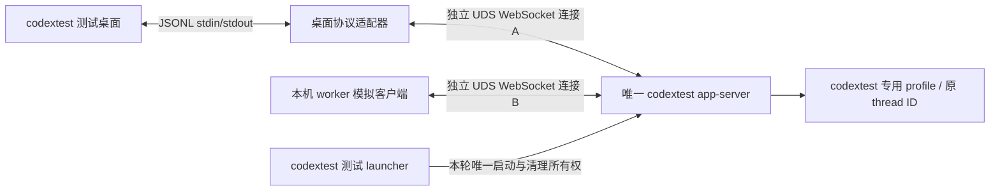

# codextest 单执行器薄桥原型：操作与验收

更新：2026-10-15。执行者：接手的 MiniMax agent。本轮只实现、运行和验证 codextest 原型，不切换正常用户的 Codex。

## 直接交给 MiniMax 的任务

> 阅读 AGENTS.md、本文件及 `docs/DESKTOP_EXECUTOR_ATTACH_RESEARCH.md`。在 codextest 用户的工作副本中，实现“桌面 JSONL 协议适配器 + 唯一 UDS/WebSocket app-server + 独立 worker 客户端”的本机薄桥原型，先做协议测试，再运行 codextest 真实桌面兼容和同 ID 续聊验证。用户已允许本次 codextest 原型：可按本文前置条件启动、关闭、重启本轮 codextest 测试桌面及自身测试组件，不需要再次询问是否选择薄桥。正常用户 liutianwei 的 Codex、profile、认证、进程、启动环境和会话均不得修改、连接、终止或重启；共享安装包只读。保留默认 native 停用守卫，不做 ECS/手机/公网验证，不安装全局自启动，不提交/推送代码，不启动其他 agent。实际阻塞则记录具体条件；不得通过去掉隔离或另起共享 profile writer 继续。完成后提交实现说明、逐项结果、恢复记录及本地证据路径。

本文件优先于旧阶段 B 的待授权描述及 `.runtime/attach-validation/.../PHASE_B_PLAN.md` 中的“原样字节透传”方案。历史报告保持原样，不当作本轮的操作依据。

## 1. 授权与路径边界

| 对象 | 本轮允许的操作 |
|---|---|
| codextest 专用工作副本、原型代码、测试目录 | 开发、构建、测试、保存证据 |
| codextest 测试桌面 | 核对身份且无非测试活动后，使用本轮显式启动方式运行/关闭/重启，完成可恢复实验 |
| codextest 专用测试项目/会话 | 新建、同 ID 续聊、只读提示词、合成审批及故障实验 |
| codextest 认证 | 由该用户独立登录；已有独立登录可使用，不导出 token，不读取正常用户认证 |
| 正常用户 liutianwei | 仅记录进程 UID/PID/父 PID/启动时间等必要元数据；不连接执行器，不打开/发送/修改其会话 |
| `/Applications/ChatGPT.app` | 只读读取 CLI、版本及静态代码，不改 app.asar、不替换文件、不升级/降级 |
| 正常用户的 Codex 数据、Keychain、工具管道、LaunchAgent、shell 配置 | 禁止读写或复用；项目源码交接不包含这些对象 |
| ECS、手机、远程控制配对、系统网络配置 | 本轮不操作、不部署 |

上次观察到 codextest UID 503、liutianwei UID 502；不能据此硬编码 PID 或复用旧 PID。本轮动态核对用户。发现正常用户进程发生变化时记录时间和事实，不能宣称变化由本原型造成或自动代为修复。

codextest 缺少独立登录时，明确报告 `BLOCKED: codextest login required`，让用户在该测试账号完成登录；不复制正常用户的 `auth.json`、cookie、Keychain 或 `CODEX_APP_TOOLS_PIPE_PATH`。

## 2. 本轮要实现的结构



“薄桥”指**本机协议适配**，不是拦截现有桌面进程的 stdio，也不是向一条原生连接拼接两个客户端的字节流。

- 桌面侧保留 JSONL 接口；适配器按完整 JSON 消息转换为 WebSocket text frame，再把响应、通知和服务端请求转换回 JSONL。
- 桌面适配器与 worker 各自连接同一个 app-server，各自执行一次 initialize/initialized。原生 app-server 管理连接隔离、请求响应及会话。
- 不自行合并两个连接的 request ID；不伪造桌面身份给 worker；不把收到的所有帧广播给所有客户端。
- 本轮只使用同一 macOS 用户下的 UDS，默认不创建 TCP listener。官方 `app-server proxy --sock` 只是字节管道，不能直接接 JSONL 客户端。
- 不对正常用户或 codextest 已运行的旧 stdio 进程实施“热加端口”。这是 codextest 的替代启动链路实验。

## 3. 工作副本与身份预检

### 3.1 准备可访问的源码

当前实现大量未提交。不要用远端旧 clone 或 `git archive HEAD` 代替当前源码，也不要更改正常用户 HOME 的权限来获得访问。

使用 codextest 拥有的项目工作副本；若跨用户不可读，由源码持有者交接明确的源码文件、AGENTS.md、锁文件及所需测试素材。**不复制整个 `.runtime/`、`.codex/`、认证文件或带私有配置的 node_modules。** 在测试工作副本按锁文件安装依赖，不安装全局 CLI，不静默升级依赖。记录源码清单和摘要；`git status` 对未跟踪文件只能显示目录，不能证明内容完全相同。

本轮原型实现、依赖、证据和运行配置均放在 codextest 专用目录。正常用户仓库只作为交接来源；需要回交代码时提供精确 diff/文件清单，不覆盖其未提交内容。

### 3.2 先在 codextest 终端执行预检

以下块只做身份/版本检查及创建证据目录，不启动桌面或执行器。`node` 必须是 codextest 自己可用的 Node 22+；不要临时借用正常用户的 nvm 配置。项目目录示例可改为实际测试工作副本，但不得改成正常用户的 Codex 数据目录。

```bash
set -eu
umask 077
test "$(id -un)" = codextest
cd /Users/codextest/Projects/rmtcdx
TASK_BRIDGE_EVIDENCE="$PWD/.runtime/thin-bridge/$(date +%Y%m%d-%H%M%S)-$$"
mkdir -p "$TASK_BRIDGE_EVIDENCE"
chmod 700 "$TASK_BRIDGE_EVIDENCE"
export TASK_BRIDGE_EVIDENCE

node --input-type=module > "$TASK_BRIDGE_EVIDENCE/preflight.json" <<'NODE'
import fs from 'node:fs';
import os from 'node:os';
import crypto from 'node:crypto';
const account = os.userInfo();
if (account.username !== 'codextest' || account.uid === 0) throw new Error('wrong_test_user');
if (os.homedir() !== '/Users/codextest' || process.env.HOME !== '/Users/codextest') throw new Error('wrong_test_home');
if (Number(process.versions.node.split('.')[0]) < 22) throw new Error('node_22_required');
if (process.env.CODEX_HOME && fs.realpathSync(process.env.CODEX_HOME) !== '/Users/codextest/.codex') throw new Error('unexpected_codex_home');
const bundle = '/Applications/ChatGPT.app/Contents/Resources/codex-cli';
const version = JSON.parse(fs.readFileSync(bundle + '/codex-package.json')).version;
const binary = bundle + '/CodexCLI.app/Contents/MacOS/codex';
const sha256 = crypto.createHash('sha256').update(fs.readFileSync(binary)).digest('hex');
console.log(JSON.stringify({ username: account.username, uid: account.uid, home: os.homedir(), node: process.version, version, sha256 }));
if (version !== '0.162.0-alpha.17.2' || sha256 !== '0d5ac7aae20c4eda6242428d5e218c55ba96d8763fda2a271088ff37104b9d28') {
  throw new Error('bundled_cli_changed_review_before_launch');
}
NODE
```

如果前置目录、Node 或权限缺失，记录实际缺项后处理测试环境，不反复尝试正常用户路径。不要从正常用户的 Codex 工具 shell 继承环境后仅替换 HOME 来假装已切换用户。

### 3.3 记录正常用户和测试用户基线

只读记录应用相关进程的 UID/PID/父 PID/启动时间/可执行文件名，按用户分组；不要转储 `ps eww`、完整 argv、环境或配置覆盖值。检查工具目前不按 UID 筛选，不能把它列出的所有 app-server 都视为同一用户的重复 writer。

对正常用户本轮不做协议握手或 UI 操作。对 codextest 核对 GUI 会话、userData、单实例锁、profile、listener 和所有者。若 codextest 有非本轮任务，先暂停接入实验；不能把“测试用户”当成随意中断任何任务的理由。

## 4. 实现交付物与硬约束

当前 `business/src/attach-adapter.mjs` 只是 `validated_only` 骨架，执行会返回 `attach_not_implemented`，且未接入 agent.mjs；既有测试数通过不代表真实连接已实现。

接手 agent 应在测试工作副本提供：

| 交付物 | 必须具备的行为 |
|---|---|
| codextest 测试 launcher | 校验用户、版本、配置及独占性；只拥有本轮执行器的启动/停止权；提供 dry-run、状态和精确清理入口 |
| 桌面 CLI wrapper / JSONL↔WS 适配器 | 能被测试桌面的显式启动链路使用；保留原 CLI 参数与 codextest 桌面环境；只改 transport，处理双向完整协议 |
| 本机 worker 模拟客户端 | 附加到已验证 UDS；无启动/停止/重启/升级权限；缺失 endpoint 时失败关闭 |
| 协议/生命周期测试 | 覆盖第 6 节矩阵，包含真正的双客户端断言，不仅测试一个复制的 dispatcher 函数 |
| 操作脚本及报告 | 所有命令验证 UID；可 dry-run；列明本轮 PID、端点、日志和回退范围；不得依赖操作者记住隐含环境变量 |

上述 launcher/适配器目前尚未交付。**本文件不提供一个假装已经存在的启动命令。** 实现者先提供它们的实际文件路径、`--help`、dry-run 输出和可复制的 start/status/stop 命令，完成本地测试后再执行 codextest 桌面阶段。

### 4.1 参数与配置保留

- 从 **codextest 桌面启动 wrapper 时收到的真实 argv** 解析 app-server 调用，参数以数组传递，不经过 shell 重拼；保留 `-c` 值、插件、code-mode-host、analytics 等全部原有选项，只按已验证语法替换/增加一个 UDS listen 端点。
- 还要对照启用 wrapper **之前**的 codextest 桌面基线。自定义 CLI 路径可能影响桌面上游的 runtime/插件选择；仅证明“wrapper 收到什么就转发什么”不足以证明功能与原启动方式等价。发现缺失项时在测试环境补齐并重测，不伪造参数等价结果。
- 不删除配置覆盖，不通过改 host kind/清空数组绕过 daemon 分支，不给共享安装包打补丁，不设置全局 `launchctl setenv`、shell 初始化文件或其他用户可继承的启动变量。
- CLI wrapper 若还会收到版本查询、code-mode-host/exec-server 等调用，要明确区分并保留需要的行为；未知调用应明确报错，不能递归启动 wrapper 或意外再启动 app-server。辅助子进程不等于第二个会话 app-server，必须按角色计数。
- 同一 profile 的旧 codextest app-server 必须先按本轮测试流程正常关闭并确认退出，再启动原型。不能在旧进程仍写入时另起一个 app-server，也不删除其锁来抢占。
- 测试桌面最初由干净的 codextest 环境启动，排除来自正常用户的 CODEX 线程身份、管道、代理及注入变量。随后 wrapper 保留该**测试桌面自己生成**的工具环境；对管道/回调核对 UID 和所属桌面实例，不能把工具环境全部清空后宣称功能保持一致。
- 日志只记录配置键、数量、等价检查结果及必要摘要，不记录原始配置值、cookie、token、完整提示词或历史正文。

### 4.2 单一执行器与进程所有权

- 本轮 test launcher 管理唯一 owner；桌面 wrapper 的首次启动参数交接要有独占锁和配置核对。并发启动必须只得到一个 owner；配置不一致或旧 owner 不明时停止，不自行接管。
- 桌面适配器和 worker 只拥有各自连接。退出任一客户端不停止 owner；两端都断开时，本轮 owner 仍由 test launcher 掌握，最终由明确清理动作停止。
- 不依赖父进程 PID 或 socket 文件存在来认定 owner 正确。联合核对 UID、可执行文件/版本、本轮 PID 与启动时间、监听归属、profile 和配置等价性；过期 PID/状态文件不得直接用于 kill 或重连。
- UDS 优先使用 codextest 私有目录，记录 canonical advertised path、实际 alias 和 listener。官方实现实际使用 `/private/tmp/codex-daemon-<uid>/`，只允许本轮 hash 对应的 socket/lock；不扩大权限、不清理其他条目。
- 不把当前 adapter 骨架的 `unix-direct`/`ws` 校验当成完整认证；它还没有证明父目录安全、listener 身份和测试用户归属。本轮禁用远程 URL，不能因 `wss:` 校验通过就连接外部端点。
- `assertNativeExecutionAllowed()` 固定停用逻辑保留。原型有独立且强制 codextest 的启动入口，不将它变成生产 native 守卫的环境变量旁路。

### 4.3 协议适配

- 每条连接 initialize 一次，随后 initialized；桌面和 worker 使用独立原生 WS 连接，相同 JSON-RPC ID 可分别正常返回给各自客户端。
- 处理 UTF-8 字符跨 chunk、单 chunk 多行、长行、空行及 EOF；明确非法/不完整 JSON 的错误行为。WS 每个 text frame 承载一条 JSON-RPC 消息；不能把换行字节直接写入 UDS 假装完成握手。
- 双向处理 request、response/error、无 ID notification，以及 server-initiated request 与客户端响应。字段、ID 的数字/字符串类型和未知扩展字段不得被丢弃。
- stdout 只输出桌面需要的 JSONL，诊断写 stderr；不要把启动 banner、debug 日志混进协议。
- 设定并测试单消息大小、缓冲总量、在途请求数、握手超时及背压上限。超限时有界失败，不无限缓存，也不靠提高上限掩盖堵塞。
- 先只读验证，再用 codextest 专用会话发送；审批、attestation、工具回调和用户输入请求按原生连接归属转交。未知审批不能自动允许/取消或广播；worker 不代答桌面的请求。
- 客户端断线不触发 turn.cancel；请求超时/响应丢失不自动重发写任务。恢复后读取状态核对结果，不能用“只执行了一次”的本地意图替代原生 turn 证据。

## 5. 执行顺序

| 阶段 | 操作 | 进入下一阶段的条件 |
|---|---|---|
| P0 身份与基线 | 第 3 节预检；记录两用户进程、测试目录/配置、正常用户保护清单 | 确认所有可写/可控对象属于 codextest，本轮无其他测试任务冲突 |
| P1 离线协议原型 | fake server 测协议和错误路径；独立 sandbox fixture 测双 WS 客户端，先不打开真实桌面、不登录、不做模型推理 | 矩阵中的协议、归属、隔离、失败关闭及清理项通过 |
| P2 实际命令 dry-run | 展示 wrapper 如何被 codextest 桌面使用、参数等价、owner 启动/复用/停止条件及回退 | 文件和命令均存在，UID/锁/原 PID 保护测试通过，无系统或正常用户设置改动 |
| P3 codextest 桌面 | 确认测试桌面空闲；记录原启动方式并关闭其旧执行器；用本轮显式环境重启测试桌面；核对真实进程与 UDS | 桌面和模拟 worker 确实连接同一 owner；未出现第二个 codextest profile writer |
| P4 功能与故障 | 第 6 节逐项验证，模型请求只限专用测试会话；逐项恢复后再执行下一故障 | 有实际证据的 PASS，缺条件标记 BLOCKED/NOT_EXECUTED |
| P5 恢复 | 先断开本轮 worker/适配器，再由 test launcher 清理本轮 owner 与精确端点，恢复 codextest 原启动方式 | codextest 退出原型；正常用户元数据复核；无全局设置/自启动/遗留第二执行器 |

P1 对合成 fixture 的 `thread/name/set` 可用；P3/P4 不给用户原有会话改名。模型推理需独立登录和网络条件，缺失时不能以离线 resume 代替问答验收。

此前 41/41 是旧测试与骨架测试的基线。本轮 JS/TS 有改动时，运行测试工作副本中的 `npm --prefix business run build` 和实际相关测试，记录新分母和新增覆盖，不以旧数字宣称本原型通过。

## 6. 必测矩阵

所有故障注入均只针对本轮 codextest 组件或可丢弃 fixture，按测试记录精确 UID/PID/启动时间确认后操作。不能对正常用户进程注入故障。

| ID | 场景 | 通过标准 / 证据 |
|---|---|---|
| B01 | 错误用户、HOME、profile、端点 owner | 启动前拒绝；无进程、配置、端点副作用 |
| B02 | 参数保留与子命令分流 | 真实 argv 配置结构等价，仅 transport 改变；未知命令不回退起第二执行器 |
| B03 | JSONL 与 WS 编解码 | 中文跨 chunk、多行、长消息、数字/字符串 ID、扩展字段语义一致；stdout 无污染 |
| B04 | 双客户端初始化与 ID 冲突 | 两端独立 initialize；同时使用 ID=1 等也各收各的响应；无 Already initialized 串扰 |
| B05 | 服务端反向请求 | fake server 能验证请求与响应双向透传；真实桌面的审批/工具回调只到正确连接 |
| B06 | 已有测试历史 | worker 读取与 resume 同一 thread ID 和上下文标记；不新建同名会话蒙混 |
| B07 | 两端续聊 | 桌面与 worker 先后发测试标记，双方读取同 thread ID、同新增 turn ID、同完成结果，实际仅执行一次 |
| B08 | 登录与功能兼容 | 独立登录可用；模型、cwd、插件、MCP、桌面工具与权限/审批行为实测，回调不指向正常用户 |
| B09 | 仅退出/断开 worker | owner 和测试桌面继续可用；桌面可完成后续只读问答；无 turn.cancel、无自动重发 |
| B10 | worker 重连 | 同一 owner、同历史可读；只恢复状态，不重复写入 |
| B11 | socket 缺失/假 alias/不安全权限 | worker 失败关闭；不 bootstrap、不调用 nativeAdapter、不尝试其他用户 socket |
| B12 | owner 退出 | 桌面/worker 明确报告连接故障；无后台起第二 owner、无不明写任务重放 |
| B13 | 桌面协议适配器崩溃 | 如桌面断连，必须如实记录；owner 状态、重连和恢复行为可解释，无两个 writer 或提示词重复。不得宣称适配器崩溃对桌面零影响 |
| B14 | 活跃 turn、并发和审批 | worker 不抢占桌面任务、不覆盖权限、不代答；并发写策略有原生证据，无串会话 |
| B15 | 超时、背压、非法/超限消息 | 内存/队列有界，错误清晰；另一条健康连接继续可用，或明确记录限制；不自动重发写任务 |
| B16 | 同时启动两个 wrapper | 原子地拒绝重复 owner，或连接同一个经核验 owner；配置不匹配失败，不删锁抢占 |
| B17 | 正常用户隔离 | 无其会话 RPC、profile/工具管道访问或进程控制；前后进程元数据有证据，UI 未观察则标记未观察 |
| B18 | 回退与残留 | 仅清理本轮对象；codextest 恢复原启动方式；正常用户未被本轮改动；无全局环境/自启动残留 |

### B07 的最小只读提示词

1. codextest 桌面在专用测试项目中创建会话，发送：`只回复 BRIDGE_A_<本轮唯一标记>；不要执行命令或修改文件。`
2. 完成后保存 thread/turn ID；worker 打开此已有会话并发送：`只回复上一条标记，再追加 BRIDGE_B_<本轮唯一标记>；不要执行命令或修改文件。`
3. 两端回读该 turn，核对原 thread ID、同一新增 turn ID、前一标记确实来自上下文且没有重复 turn。可再从桌面发送第三条标记验证反向接续。
4. 这是 codextest 桌面与**模拟 worker**验证，不是 APK 真机/ECS 端到端。APK 尚未参与时，报告必须写 `APK: NOT_EXECUTED`。

审批验证先用 fake server，真实审批仅在受控测试项目制造无副作用请求并逐次人工核对。无合适工具或测试条件就标记 BLOCKED，不临时扩大权限制造“通过”。

## 7. 停止条件与恢复

- 当前 UID 非 codextest、任何资源指向正常用户、listener 身份不明、出现第二个同 profile writer、原型需修改共享安装包或绕过 native 守卫：立即停止原型，保留证据。
- 适配器位于桌面连接链路，**它崩溃可能使测试桌面断连**。worker 退出不影响桌面与适配器崩溃无影响是不同要求，不能互相替代。
- 只终止已重新核对 UID/PID/启动时间/本轮归属的测试组件。不使用 `killall`、`pkill codex`、通配符清空 socket 目录、删除数据库或移除不属于本轮的锁。
- 操作仅在 launcher 的显式环境生效；恢复应撤掉本轮 wrapper/环境覆盖，用 codextest 原启动方式启动，确认旧原型 owner 已退出，避免恢复时再出现两个 writer。不要用回滚数据库来“撤销”测试聊天。
- 若正常用户恰好手动重启/更新，记录时间和不可归因状态；不得代为重启以验证原因。
- 不把原型成功自动升级为真实用户切换或 ECS 部署授权；正常用户迁移另行提出具体、可回滚步骤。

## 8. 证据与汇报

证据放 codextest 专用目录，目录 0700、文件 0600；按需保留本轮测试标记正文，不保存用户聊天或认证。建议文件清单：

```text
preflight.json
source-manifest.json
process-baseline.json / process-after.json
launch-dry-run.json / endpoint-owner.json
config-equivalence.json
protocol-tests.log / build.log / business-tests.log
cases.json                         # B01–B18 的状态、证据引用、未测原因
lifecycle.jsonl                    # 本轮组件角色、UID/PID、连接/退出/清理
test-thread-evidence.json           # 专用测试 thread/turn ID 与标记比对
restore.json
REPORT.md
```

日志脱敏且有界。只用 `git status` 相同不能证明未跟踪文件未变；只用 PID 相同不能证明 UI 正常；只用同标题不能证明同会话；只用固定返回 `ready=false` 的骨架测试不能证明实际附加完成。

报告开头使用以下结构：

```text
结论：仅 codextest 薄桥原型 PASS / FAIL / BLOCKED
实际范围：P0–P5；B01–B18 PASS n/18、FAIL n、BLOCKED n、NOT_EXECUTED n
桌面真实 UI / 模型推理 / 模拟 worker / APK / ECS：分别标明是否执行
原型结构与实际 start/status/stop/restore 命令：
唯一 owner 的 UID/PID/版本、两个客户端连接证据：
同 ID 和上下文连续性证据：
登录、插件、MCP、审批兼容结果：
worker 退出与适配器崩溃分别影响：
正常用户保护核对及未观察范围：
恢复、残留、代码清单和证据目录：
剩余缺口：不得用未来计划代替本轮结果
```

本轮结束后不要自动转阶段 C，不连接荣耀或部署 ECS；等待用户根据原型结果决定下一步。
