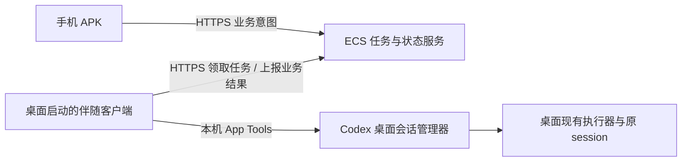

# 同一 Mac 账户下，通过桌面 App Tools 接入原会话

核查日期：2026-10-15。状态：**真实只读接入已验证；写入、常驻生命周期、ECS/APK 链路尚未验证。**

> 后续进展：已在新建的专用测试会话完成原 ID 续聊、用户确认的桌面同步、桌面工具托管生命周期、ECS 和荣耀 APK 验证。MCP 常驻包装与桌面重启自动恢复仍未验证，详见 [验收记录](DESKTOP_COMPANION_ACCEPTANCE.md)。下文保留只读研究阶段的证据边界。

## 结论

推荐将下一轮原型转为「由桌面启动的伴随客户端 → 桌面 App Tools → 桌面现有执行器」。保留现有 ECS 业务任务架构，替换 Mac 端适配器。无需另一个 macOS 账户。

`THIN_BRIDGE_HANDOVER.md` 对 stdio 独占、CLI override 不可配置等结论仍有价值；但由此推出“APK 读取真实历史没有路径”超出了证据范围。本轮找到并实测了另一层入口：桌面内置 `codex-app-tools` 的 native pipe。它调用桌面已有的工具分发链，不要求改桌面 CLI 的启动命令。

这仍然是**安装包内部接口研究**。公开 MCP 文档支持桌面启动本地 stdio 服务，并未承诺第三方程序可稳定调用此 native pipe。不能将读取成功报告为手机已能续聊。

## 已验证的事实

本轮没有向已有会话发送消息，没有新建聊天，没有修改桌面配置、签名或数据库，没有启动第二个 app-server；未启用 ECS 执行器。

| 检查 | 观察 | 证据边界 |
| --- | --- | --- |
| `tools/list` | 返回 `codex_app` 工具目录 | 接口存在且当前连接被接受 |
| `list_projects` | 45 个本地项目，含同路径的独立命名项目；全部来源合计 53 个项目 | 云项目不能归入本机可执行项目 |
| `list_threads(limit:50)` | 6 条置顶 + 50 条最近会话 | 不是全部历史会话数量，也不是完整的按项目分页接口 |
| `read_thread` | 按现有会话 ID 读取最近一轮，返回 ID 一致；该轮包含 25 个 item | `hasMore=true`，未验证全部历史；接口会截断正文/输出 |
| 写工具目录 | 存在 `send_message_to_thread`、`create_thread` | 只确认 schema，没有调用它们 |
| 普通 npm Node 直接连接 | 连接关闭，探针非零退出 | 不能使用普通独立 Node worker 直接上线 |
| 随包 Node 由普通 Node 中转启动 | 内置 MCP server 报 `Codex app tools pipe closed` | 仅替换 Node 路径不足以保证被接受 |
| 随包 Node 从桌面工具执行链直接 `exec` 启动 | 工具目录、项目、会话读取成功 | 仅证明当前启动链，不代表 LaunchAgent、Terminal 或重启后可连接 |

结构化证据保存在忽略目录 `.runtime/desktop-control-research/readonly-report.json`；包含会话 ID 相等、数量和 item 类型，不含正文、路径、项目名称或凭据。

## 为什么这个入口不同

当前安装包的 `plugins/openai-bundled/plugins/codex-app-tools/server.mjs` 已提供客户端实现：

- 从 `CODEX_APP_TOOLS_PIPE_PATH` 获取桌面提供的 Unix socket。
- 采用 `4 字节 UInt32LE 长度 + UTF-8 JSON`，单帧上限 8 MiB；**不是** app-server 的 JSONL 或 WebSocket。
- `tools/list` 获取工具目录；`tools/call` 发送命名空间、工具名、参数与真实调用方会话上下文。
- 向桌面传入 `callerSource`、`hostId`、`threadId`、`turnId`、`callId`。内置客户端在没有 turn 元数据时也会生成 `mcp-turn-*` 关联 ID；它不是新建模型轮次。

安装包 `main-CwxgTOle.js` 的 `hoe → voe → callDynamicAppTool → g_e` 将请求交给现有桌面窗口的工具分发服务。`app-shared-8340f229c2b3.js` 的 `Sli / Cli / bli` 检查调用方上下文并分发操作。由桌面自身处理目标会话，因而不必再启动一个进程去 `thread/resume` 共享 profile。

`jf()` 调用 native peer authorizer；其二进制包含签名身份与 peer / parent / grandparent 的校验线索。随包 Node 的签名为 OpenAI `2DC432GLL2`，本机 npm Node 为 Node.js Foundation `HX7739G8FX`。本轮的接受/拒绝结果与签名和祖先进程校验有关，**完整规则尚未还原，不能归纳为“所有签名 Node 都能连接”**。

当前主 bundle SHA-256：`87d52265eb13608a380fabcac47ecf13a39b981115c0960c18af563ea6d32d51`。安装包更新后重新核查。不禁用 authorizer、不注入进程、不伪造调用方身份，也不修改签名。

## 推荐架构



手机只提交固定业务操作与服务端登记的对象 ID。ECS 仍执行归属、租约、去重及状态迁移，不对外开放 native pipe、通用 MCP 或原始 RPC。

建议的落地顺序：

1. **启动方式先验收。** 先复用本轮成功的桌面工具启动链；再验证一个由现有桌面 app-server 启动的本地 stdio MCP 伴随服务。后者使用随包 Node，端点来自桌面注入，调用方上下文来自显式启用操作的真实元数据。它是待验证设计，本轮未安装 MCP、未改 `config.toml`。
2. **在伴随进程中领取业务任务。** 进程本身执行固定映射，无需每次调用模型来转发手机提示词。与当前 `agent.mjs` 的适配器接口对接，不移除 `assertNativeExecutionAllowed()`，不恢复 native 启动分支。
3. **先交付文本能力。** 项目、目录、单条快照和显式发送意图逐项验收。只有确实支持的任务类型才能被领取；不能把现有 `OPERATIONS` 全量声明为可用。
4. **结果由快照开始。** native pipe 的请求/响应不是 app-server token 流；先使用完成状态和分页快照生成业务投影。实时增量需另做游标、截断、轮次归属及重连验证。

由桌面启动的 stdio MCP 是公开支持的扩展形式，native pipe 的第三方复用及此处伴随进程的生命周期仍需单独验证。官方配置说明：[Model Context Protocol](https://learn.chatgpt.com/docs/extend/mcp)。

## 能力缺口与验收要求

| 能力 | 下一步要求 |
| --- | --- |
| 全项目会话目录 | `list_threads` 只有最近 50 条加置顶；补充分页或有界只读索引。保留显式项目归属，同路径项目不能简单按 cwd 合并 |
| 完整聊天历史 | `read_thread` 是分页摘要接口，输出有截断。确定产品要展示的完整程度；如需读取本机历史文件，另外验收路径白名单与数据格式，不写原库 |
| 原 ID 续聊 | 先在专用测试项目的一条闲置测试会话发送只读提示词，验证两端同一会话 ID、新轮次可关联、桌面可见与上下文保留 |
| 活跃会话 | 验证 `send_message_to_thread` 的队列/steer 语义与桌面同时发送的竞态。手机侧锁只能串行化手机请求，不能证明桌面输入已被互斥 |
| 发送回执 | “消息已提交”不能等同于轮次完成。保存意图后执行；回执丢失先核对，无法证明结果则 `unknown`，禁止自动重发 |
| 中断、审批、附件 | 本轮没有验证可用入口，`send_message_to_thread` schema 只有文本及可选模型设置。首轮声明为不支持，不从正文模拟批准操作 |
| 生命周期 | 当前聊天结束/归档、关窗、睡眠、伴随进程退出、socket 重连、桌面升级/重启分别验收。失去有效调用方上下文应停止领取任务，不能扫描其他进程环境补身份 |
| 常驻负载 | 单 owner，任务按需读取；禁止全历史高频轮询。约束缓存容量、快照大小、读取速率与子进程数量 |
| ECS 与 APK | 本轮未测试。仅在本机读写与生命周期通过后复用 HTTPS 任务服务做纵向验证 |

MCP 生命周期验收若失败，先保留“桌面内显式启动、失效后重新启用”的人工启动原型，不能据此承诺无人值守常驻。只有调用方上下文长期可用和重连路径均获验证，才考虑自动恢复。

## 其他路线的定位

- **原薄桥**：继续保留协议测试成果，不再以寻找 CLI override 作为主线。其 write-gate 尚未接入的事实不变。
- **同账户、独立 HOME/CODEX_HOME**：技术上不需要另一个 macOS 账户，但它产生的是隔离执行历史；不能自动等价于桌面原 session。现有隔离审计与 native 停用守卫仍生效。
- **桌面 UI 自动化**：原窗口的文本发送可以作为后备实验，但存在焦点、锁屏和界面变动限制，暂不作为主接入路径。
- **官方 Remote**：公开产品路线可参考，但不能把官方私有配对/中继接口直接替换成 ECS；见 `OFFICIAL_MOBILE_CONNECTION_RESEARCH.md`。
- **`codex queue`**：当前 npm CLI 确有该命令，并允许指定远端端点。本轮只检查帮助和命令分发源码，未验证默认端点发现/启动行为，也未执行发送；不能由命令存在推定它能接入当前 stdio 桌面。

## 复现与本轮验证

新增只读脚本 `scripts/probe-desktop-app-tools.mjs`。应当在已有 Codex 桌面工具中直接执行，保留桌面正常提供的调用方上下文：

```bash
exec /Applications/ChatGPT.app/Contents/Resources/cua_node/bin/node \
  scripts/probe-desktop-app-tools.mjs \
  --output=.runtime/desktop-control-research/readonly-report.json
```

默认读取当前调用方会话；传 `--thread-id=<实际已有的本地会话 ID>` 可以只读检查另一条会话。没有调用方上下文时拒绝；不自动发现其他端点、不回退新执行器。该命令不能被当成已经可用的 Terminal/LaunchAgent 启动配置。

- 随包 Node 直接执行：真实只读探针通过；重复取得同一条现有会话。
- 普通 npm Node 执行同一脚本：非零退出，`app_tools_pipe_closed`。
- 缺少桌面调用方上下文：连接前非零退出，`desktop_caller_context_required`。
- 脚本只允许 `list_projects`、`list_threads`、`read_thread`；不开放原始 `tools/call` CLI 参数。
- 单独调用写工具被 `read_only_probe` 在建连前拒绝；检查报告中的请求/返回 ID 一致，正文临时样本已清理。
- `node --check scripts/probe-desktop-app-tools.mjs` 通过。
- `npm --prefix business run build` 通过。未修改业务运行代码，未重跑不相关的原型/Android 全量测试。

本轮只新增可复现探针与方案记录；没有提交、推送、部署或改变桌面运行配置。
