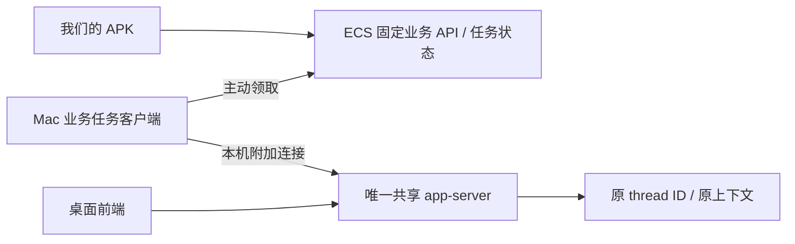

# 接入桌面已有执行器：候选入口与隔离验证

日期：2026-10-15。目标是 APK 与桌面共用同一个执行器及原会话，不启动第二个写入桌面 profile 的 app-server。

接手执行与验收请使用[操作与验证交接文档](DESKTOP_EXECUTOR_ATTACH_TEST_RUNBOOK.md)，其中阶段 A 可直接复测，阶段 B/C 有明确前置条件。

最新决定：用户已指定 MiniMax 在 codextest 内实现和验证[单执行器薄桥原型](CODEXTEST_THIN_BRIDGE_PROTOTYPE_RUNBOOK.md)。桌面适配器与模拟 worker 分别连接同一 UDS app-server；正常用户 Codex 不参与。本节之后的历史事实保留，不构成直接切换命令。

## 结论

当前版本具备共享执行器的协议能力。使用桌面自带 CLI，在独立离线 fixture 中实测两客户端接续同一条合成历史，保持相同 ID，断开客户端不终止执行器，重连仍可看到该会话。

但是当前桌面进程是 stdio 路径，未发现可连接的本地控制 socket；无法据此对它实施无重启接入。没有改变它的启动方式，也没有向它发送探测 RPC。

更重要的是，安装包虽保留 local-daemon 分支，正常桌面 factory 的配置覆盖数组并非空，不能简单设置一个环境变量就断言桌面会使用 daemon。实际切换仍需要配置兼容性验证和桌面维护操作，本轮没有执行。

## 静态证据

本机版本 `0.162.0-alpha.17.2`。只读检查安装包 `app.asar`：

### 本地共享 daemon 分支

`application-network-startup-YSC7OAs0.js` 的连接逻辑包含以下必要条件：

- 非 Windows，本地主机；
- 配置覆盖数组为空；
- `CODEX_APP_SERVER_USE_LOCAL_DAEMON === "1"`；
- 未强制 CLI，未指定 CLI 路径/自定义命令/自定义 runtime；
- `app-server daemon version` 的版本检查通过。

该分支使用 `ws://localhost/rpc` 的 WebSocket 握手，底层通过 Unix socket 连接 `~/.codex/app-server-control/app-server-control.sock`，不是实际建立 localhost TCP 连接。

`main-CwxgTOle.js` 的正常 factory `A5` 给该 transport 提供配置覆盖生成器，其中无条件包含 `xYe(e)` 返回的一条 code-review plugin 配置。因此仅启用上述环境变量不能保证走入共享 daemon 分支。此结论来自代码条件，不是对当前桌面进行重启实验。

### WebSocket 地址覆盖

安装包还识别 `CODEX_APP_SERVER_WS_URL`，可优先选择 WebSocket transport。但这条 factory 路径绕过 stdio 的逐次配置覆盖回调。登录、插件、工具、权限及工作目录行为必须单独核对；没有将此变量设置到当前应用，也没有创建本地 TCP 桥来切换桌面。

### CLI proxy 的实际含义

本机 CLI 帮助确认 `app-server proxy --sock PATH` 存在。开源 `codex_stdio_to_uds::run` 仅做 stdio 与 UDS 字节复制，不负责 JSONL 与 WebSocket 之间的转换。

因此不能把原来的 JSONL 客户端直接改成执行 proxy 后就认为完成适配。测试先暴露 initialize 超时，核查协议后改为真正的 UDS WebSocket 客户端。

## 系统隔离细节

官方 UDS 实现把公开 socket 路径作为 rendezvous alias，实际监听文件放在 `/private/tmp/codex-daemon-<uid>/<sha256(canonical-advertised-path)>`，另有同名 `.lock`。该目录故意独立于 HOME、CODEX_HOME 和 TMPDIR。

第一次 fixture 启动被系统沙箱拒绝，检查源码后才识别此路径。最终探针：

- 使用全新权限 0700 的临时 HOME/profile/workspace，无桌面凭据、数据库、会话或环境继承；
- 系统沙箱拒绝桌面 `.codex` 与 Keychains 读取；
- 禁止 TCP，实际 loopback 监听返回 EPERM；
- 仅允许 fixture 目录、这一随机 rendezvous 对应的实际 socket/锁文件，以及共享目录本身的创建；不允许写入其他既有 socket/锁或桌面状态；
- 结束后关闭自身客户端、终止自身进程组、移除本次独有文件；仅在共享目录由本次创建且为空时才移除该目录。

这比“HOME 不同”多了一层实际系统权限约束。它不是生产部署方案，也不是运行隔离审计的自动放行条件。

## 已执行的隔离实验

脚本：`node scripts/probe-shared-executor.mjs`。需要现有上游 checkout 中的 `ws` 依赖，仅供研究 fixture 使用。

| 检查 | 结果 |
|---|---|
| socket 不存在时执行 proxy | 非零退出，不创建执行器或 socket |
| 桌面侧 fixture 客户端恢复合成历史 | PASS |
| APK 侧 fixture 客户端看到同一 loaded thread | PASS |
| APK 侧 resume 保持原 thread ID，能读到合成历史标记 | PASS |
| APK 侧改名，桌面侧读取到相同名称 | PASS，仅修改合成 fixture |
| 断开 APK 侧，桌面侧继续读取内存会话 | PASS |
| APK 侧重连，仍读取到原 loaded thread 和名称 | PASS |
| 关闭两个客户端后执行器继续存在 | PASS |
| 脚本退出时清理自身执行器 | PASS |
| 模型推理、真实桌面历史、真实登录/MCP/审批 | NOT_EXECUTED |

合成历史只创建在专用临时目录，未读取或复制任何用户聊天。此处用本机 schema 标注 experimental 的 `path` 参数载入测试 fixture；不把该参数开放为业务接口，不允许远端指定本机 rollout 路径。

证据：`.runtime/business-ecs/shared-executor-probe.json`。CLI SHA-256 为 `0d5ac7aae20c4eda6242428d5e218c55ba96d8763fda2a271088ff37104b9d28`。

## 当前桌面的被动检查

脚本：`node scripts/check-desktop-attach.mjs`。

只查看进程参数的结构和 socket 文件元数据，不连接 socket，不调用 daemon version/start，不读取配置覆盖内容、环境或认证文件。

本轮前后观察到相同主进程/执行器 PID：79295 / 79963。执行器没有显式 `--listen`，默认控制 socket 不存在。该信息证明没有通过本实验切换或重启这些进程，不代表所有 UI/业务功能已完成回归。

新增元数据检查器识别官方确定性 socket alias，拒绝错误目标、不安全权限、非 socket、错误所有者或别名父目录。正向结果只表示元数据检查通过；正式连接前仍必须验证实际 listener 所有者和协议版本，不能将静态结果当作进程身份认证。单元测试确认发现过程不产生连接。

## 对业务链路的建议

该目标保留现有业务任务架构，ECS 不承载原始 app-server RPC 透传。任务客户端只管理自己的连接，无权启动、停止、重启或升级唯一执行器；丢失 endpoint 时应失败关闭，禁止回退到另起 native app-server。

真实启用前仍需完成：

当前具体执行顺序以 codextest 原型专用文档为准；本轮不进入正常用户真实切换或 APK/ECS 部署。

1. 确定桌面能够正式使用的共享 transport 配置，完整保留登录、配置覆盖、插件、MCP 和审批行为。
2. 在可丢弃的桌面测试环境验证配置兼容、权限归属及断线/重连；当前实验只是协议客户端模拟，未覆盖真实桌面 UI。
3. 只有在上述条件通过后，才形成可回滚的维护切换步骤。当前 stdio 进程不能被本探针热加监听端口，本轮不改它。
4. 第一次真实发送仅用隔离测试项目，验证两个前端读取同一条完成记录及一致 turn ID；已有用户会话先只读，活跃会话不得抢占或覆盖权限。

旧的真实执行器停用守卫保留。统一侧栏和新版业务目录同步仍未部署，本轮无 APK 真机发送验证。

## 来源与验证

- [官方 App Server](https://learn.chatgpt.com/docs/app-server)
- [官方开发者命令](https://learn.chatgpt.com/docs/developer-commands)
- 开源参考固定提交 `7c152d468447244583f5013887a4bc1371cf1f4c`：`app-server-transport/src/transport/unix_socket.rs`、`uds/src/daemon_directory.rs`、`stdio-to-uds/src/lib.rs`、`cli/src/main.rs`。与安装包行为交叉检查，不宣称源码版本逐行相同。
- `npm --prefix business run build` 成功，业务测试 25/25 通过；默认真实 native 启动仍拒绝。
