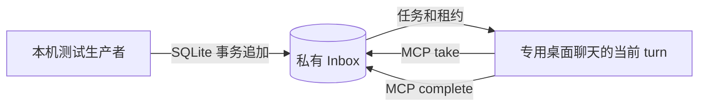

# 桌面 MCP 主动领取队列验收

> 本文是首次三条任务验收。持续领取、取消恢复与本机业务协议的后续结果见 [DESKTOP_OWNER_CONSUMER.md](DESKTOP_OWNER_CONSUMER.md)：当前要求先 open 消费窗口，再带 sessionId 领取；原型 43/43、business 51/51，ECS/APK 写入仍关闭。

日期：2026-10-15。**本机专用聊天已通过原子入队、同一 turn 顺序领取两条消息、忙时入队不改变当前 turn 的验证。采用本项目 Inbox，由桌面聊天主动领取；不调用 native start/steer，不修改桌面原生队列。ECS/APK 写入仍关闭。**

用户已接受多条手机消息在同一个桌面 turn 内处理。每条手机任务的身份是 `intentId`，桌面执行轮次另记 `consumerTurnId`；不能把每条任务伪装成新的原生 turn。

## 工作方式与范围

- 当前消费聊天：`rmtcdx companion lifecycle`，ID `01a13fef-a018-7303-a2a6-f5903548537f`，归属“专用测试项目”。MCP 校验宿主注入的 thread ID 和非空 turn ID。
- 原 `rmtcdx companion acceptance`（`01a13feb-ce80-7ca3-aa1e-17814542b353`）保留 9 个 completed turn，本轮未向其发送新消息。
- 生产者只写本机私有 `inbox.sqlite`；MCP 提供 `companion_inbox_take`、`companion_inbox_complete`，不提供手机可调用的任意执行工具。
- 本轮只为加载新增工具重载过空闲的专用控制聊天；桌面 PID `42738`、app-server PID `43367` 未变，没有重启桌面、操作其他活跃聊天或开启网络 worker。

## 原子性与恢复

`src/inbox.mjs` 使用独立 SQLite，不访问桌面状态库。文件 0600、runtime 0700，WAL + `synchronous=FULL`，所有入队/领取/完成操作使用 `BEGIN IMMEDIATE`。

1. `intentId` 唯一；同正文重试返回原回执，不同正文返回冲突。不会覆盖已有队列项。
2. 按提交顺序领取。数据库部分唯一索引限制一个处理中/unknown 任务，多个 frontend 或进程不能同时领取两条。
3. 完成要求正确租约 token 和原 MCP turn ID；同结果重复完成返回原回执，结果变化返回冲突。
4. `queued → leased → completed`。服务退出/重启将未完成租约转为 `unknown`，保留正文与意图，不自动释放或重放。unknown 没有自动清除入口。
5. 取消尚未返回任务的长轮询，不会继续在后台领取。proxy 将 take 降为非阻塞读取，避免丢失取消信号后留下隐藏轮询。
6. 元数据日志记录领取状态、意图、调用聊天及 turn、完成与恢复；不记录正文或租约 token。正文和结果只在本机数据库/测试证据中保存。

这些保证属于本项目 Inbox。原生 `atomicIdleAdmission`、`atomicQueueAppend` 仍为 false；新增 `ownerInbox.atomicLocalQueue=true`，`nativeTurnPerMessage=false`，不要混淆。

## 真实专用聊天结果

| 验证 | 结果 |
| --- | --- |
| 同一 turn 两条任务 | `owner-pull-20261015-round1/round2` 均 completed，真实 metadata 均为 turn `01a14043-5c9a-7ca0-a856-681ca6ddfec1` |
| 上下文延续 | 第一条 `PULL1 MAPLE-7319`；第二条 `PULL2 MAPLE-7319 \| PREVIOUS PULL1 MAPLE-7319` |
| 忙时入队 | 专用聊天已在 turn `01a14044-7a9d-7643-b43a-d359d12bb72a` 运行时追加第三条，立即读取仍为同一 inProgress turn，队列显示 queued，未自动注入输入 |
| 主动领取第三条 | 等待后在同一个 turn 完成，结果 `PULL_BUSY MAPLE-7319`，MCP marker `exec-7e3afa1f-838c-459a-a036-60a624baa65d` |
| 去重与冲突 | 生产者重复提交完成意图仍返回 completed，变更正文被拒，未重复执行 |
| MCP 恢复后空队列 | 严格 turn metadata 校验生效，真实 take 返回 empty；原三条仍 completed，没有重放 |
| 当前状态 | 专用聊天 idle、MCP 服务 ready、三条 completed、无处理中任务；已停止领取，没有留下无限模型轮询 |

测试生产者见 `scripts/verify-desktop-owner-pull.mjs`。`prepare` 使用固定意图并去重；已完成时不要为了重跑测试再发新的 bootstrap 聊天消息。`report` 只核对原两条结果与 native 发送回执 hash。

本机私有证据位于 `.runtime/desktop-companion-mcp/`：`owner-pull-acceptance.json`、`owner-pull-busy-enqueued.json`、`owner-pull-final.json`、`tests-owner-pull.log`。前两条 native 发送回执未变化，三条 Inbox 消息均未走伴随服务的 native send。

自动化测试 **33/33**：含四个真实生产者进程并发入队、41 条唯一任务保留、跨连接单租约、错误 token/turn 拒绝、真实子进程 SIGKILL 后 unknown 恢复、取消轮询、MCP caller/turn metadata 门禁、原有 native 恢复与业务写入拒绝测试。原型 build 与 `git diff --check` 通过。

## 当前边界与下一阶段

桌面必须先通过用户授权进入领取模式。模型退出当前 turn 后，新消息只会排队，MCP 服务不会自动唤醒聊天；当前 take 最长等 20 秒，测试没有留下持续消费轮次。桌面用户中断或改任务时，不强制延续手机任务；未完成租约保守阻塞，等待核对。

这不是原生输入队列的全局 busy 拒绝方案，也不等于可以安全向任意正在工作的聊天推送。只对明确授权、主动进入领取模式的专用聊天开放。

ECS/APK 接入前还需完成：业务协议区分任务 ID、队列状态与消费 turn；明确进入/退出领取模式和未确认结果的呈现；验证持续等待、取消及整个桌面重启后的恢复；再按项目授权。不能用假 turn ID 填充旧 `turn.start` 的 running 回执，也不能恢复非原子 send-now 作为唤醒兜底。当前业务 worker 保持停止、默认只读。
