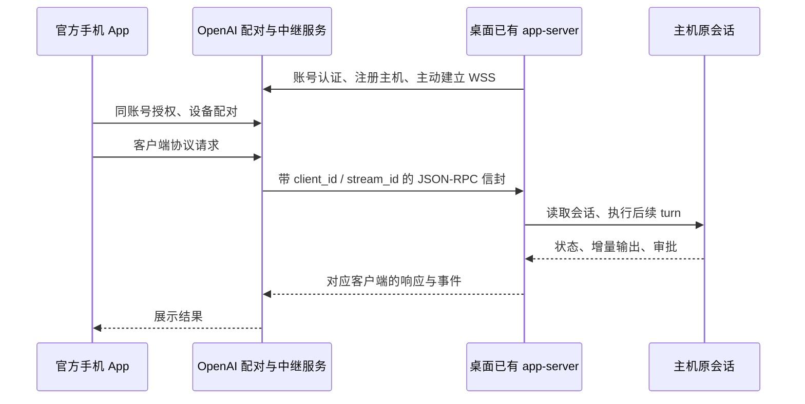

# 官方移动端接入机制核查

核查日期：2026-10-15。仅做文档、源码和安装包静态检查；未调用远程控制 enable/pairing 接口，未读取登录凭据，未生成配对码，未修改或重启桌面应用。

## 结论

官方移动端通过账号授权、设备配对及 OpenAI 应用层中继，成为主机已有 app-server 的另一个逻辑客户端。原会话仍由主机执行。它不需要在手机上复制本地数据库，也不依赖另一个 app-server 共享桌面 profile。

此前“当前进程未发现可连接的命名 socket”只排除了已观察到的本地直连接口，不能用来排除官方远程接入：官方主机端主动建立出站 WSS 连接。

这解释了原会话接续的架构，但不等于已获得自研 APK 接入官方服务的公开授权协议，也不证明能把官方中继地址改成 ECS。

进一步发现本机安装包的共享 daemon 分支，并完成隔离 fixture 的同 ID 接续/断开/重连验证；当前桌面仍无法直接附加，详见[已有执行器接入核查](DESKTOP_EXECUTOR_ATTACH_RESEARCH.md)。

## 证据版本与边界

- 本机桌面自带 CLI：`0.162.0-alpha.17.2`，版本取自安装包 `codex-cli/codex-package.json`。
- 本机 `app.asar` 的 `app-initial-1ab6fbe93c4f.js` 与 `app-shared-8340f229c2b3.js` 可见远程控制请求、订阅和客户端配对 API。它们是已安装桌面前端代码，不是 Android 源码。
- 对同一 CLI 在全新 HOME、禁止网络的系统沙箱内执行 `app-server generate-json-schema --experimental`，确认本版本协议包含远程控制及配对结构。只生成文件，没有连接运行中的桌面服务。
- 官方开源主机端参考固定到 `openai/codex` 提交 `7c152d468447244583f5013887a4bc1371cf1f4c`。它是核查时的 main，不宣称与已安装 alpha 构建逐行一致。本机前端及生成协议用于交叉确认。
- 没有抓取手机网络包、没有对官方私有服务发送认证/配对请求，移动端内部实现和服务端授权细节未做动态验证。

## 配对与认证

1. 官方文档要求手机与桌面使用相同 ChatGPT 账号和 workspace，按要求完成 MFA/SSO；主机必须在线且桌面应用运行。
2. 桌面前端把 `remoteControl/enable` 发给该 host 已有的 app-server，并订阅 `remoteControl/status/changed`、读取 `remoteControl/status/read`。
3. 等待状态 connected 后调用 `remoteControl/pairing/start`，本机前端传入 `{manualCode: true}`。响应包含 `pairingCode`、`manualPairingCode`、`environmentId`、`expiresAt`。
4. 官方文档的手机入口是扫描桌面生成的二维码并在官方 App 内完成配对。本机桌面作为远程客户端的前端还存在 `/wham/remote/control/client/pair`、客户端列表、撤销和 MFA 检查调用；这只能证明官方客户端协议存在，不能当成第三方接入文档。
5. 开源主机端通过 ChatGPT 登录身份注册 server/installation/environment，并取得有过期时间的专用 remote-control token；后续注册刷新与账户身份绑定。该模块明确拒绝普通 API key 登录。

## 消息链路和会话归属

开源 `client_tracker.rs` 的关键路径：收到 initialize 后分配逻辑 connection ID，发送 `TransportEvent::ConnectionOpened {origin: RemoteControl, ...}`；随后将消息送入 `TransportEvent::IncomingMessage`。没有为每部手机启动另一个 native app-server。

`protocol.rs` 定义 `ClientEnvelope` / `ServerEnvelope`，包含 client、stream、序号、ACK、分片、ping/pong、关闭事件。`websocket.rs` 构造主机出站 WSS 请求，携带 server ID、协议版本、installation ID 和专用 Bearer token；实现断线恢复相关游标和退避。此处证据支持 TLS 及应用层封装，未据此宣称端到端加密或云端不存储正文。

## 对自研 APK 的影响

| 问题 | 核查结果 |
|---|---|
| 能否接续原会话 | 官方产品文档支持；关键在于请求交给已有主机执行器 |
| 能否直接复用官方 relay | 公开了部分主机协议实现，尚未找到向第三方 APK 提供的完整受支持接入/授权合同 |
| 能否用 API key 接入该 remote-control 模块 | 本次开源代码明确拒绝 |
| 能否直接将 relay 改为 ECS IP/域名 | `normalize_remote_control_base_url` 限制官方域名及 loopback，不能直接替换 |
| 是否需要恢复共享 profile 方案 | 不需要，也不恢复 |
| 官方使用中继是否意味着我们的 ECS 可部署透传 | 不能据此判断。本项目仍遵守既定业务任务方案，不在 ECS 恢复通用 RPC/流量透传 |

若首要目标是使用未修改的桌面实例接续原会话，官方 Android 客户端是已公开支持的路径。自研 APK 要达到同样行为，还缺少经过验证、由桌面实例管理的接入点；仅重新实现配对页面或中继封包无法补齐这个条件。

## 可复核来源

- [官方远程连接说明](https://learn.chatgpt.com/docs/remote-connections)
- [官方 App Server 协议](https://learn.chatgpt.com/docs/app-server)
- [主机远程控制协议及地址约束](https://github.com/openai/codex/blob/7c152d468447244583f5013887a4bc1371cf1f4c/codex-rs/app-server-transport/src/transport/remote_control/protocol.rs)
- [远程客户端进入现有处理队列](https://github.com/openai/codex/blob/7c152d468447244583f5013887a4bc1371cf1f4c/codex-rs/app-server-transport/src/transport/remote_control/client_tracker.rs)
- [主机 WSS 认证与传输](https://github.com/openai/codex/blob/7c152d468447244583f5013887a4bc1371cf1f4c/codex-rs/app-server-transport/src/transport/remote_control/websocket.rs)
- [ChatGPT 认证要求](https://github.com/openai/codex/blob/7c152d468447244583f5013887a4bc1371cf1f4c/codex-rs/app-server-transport/src/transport/remote_control/auth.rs)

参考源码、revision 元数据及本机生成的远程控制 schema 均在忽略目录 `.runtime/official-remote-source/`，没有纳入项目依赖或改动官方应用。
