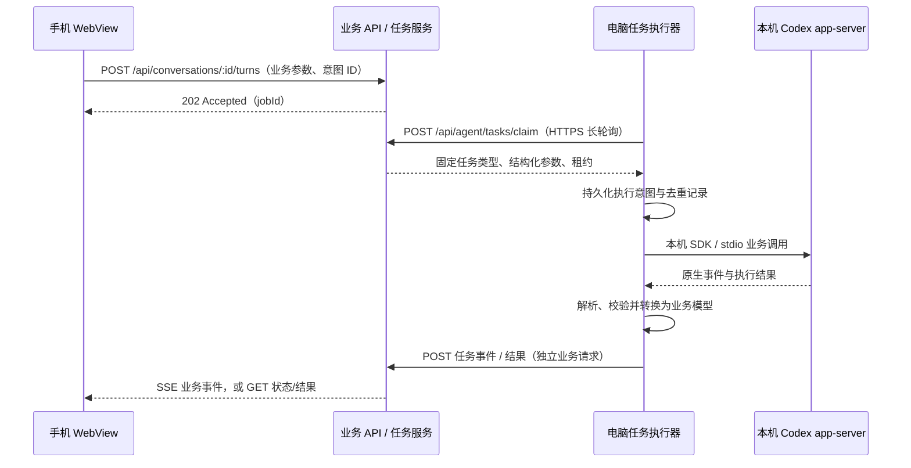

# ADR 001：用业务任务与结果同步替代流量中转

状态：核心业务链路已实现，已完成局域网及 ECS HTTPS 荣耀纵向验证；尚未达到完整功能/生产验收。

日期：2026-10-15。

## 背景与决定

用户明确要求不使用 FRP、内网穿透或直接流量转发。用户提供的服务商客服截图区分了流量穿透服务与作为业务终点的 Node.js HTTPS API。该约束适用于本项目后续架构，不能通过更换协议名或封装方式规避。

现有 `control/` 按 `{method,path,body}` 转交本机 HTTP 请求，并转发 WebSocket 事件，即使接口有白名单、电脑主动建立连接，也仍具有流量中转的本质。因此停止这条链路的验证与部署；旧代码仅保留 loopback 回归用途，并在代码中拒绝远程 origin 和非 loopback 监听。不提供绕过开关。

新方案采用服务端拥有业务实体、任务状态机和结果投影的普通 Web 应用。电脑主动通过 HTTPS 领取结构化业务任务，在本机调用 Codex app-server，提交业务结果。手机与电脑之间不建立透明通道，服务端也不把用户请求原样送到本机端口。

“业务 API”是实现约束，不是合规结论。部署前应将真实用途、接口契约与数据流交服务商确认；不能仅凭协议名称保证平台接受。

## 数据流

手机请求在服务端以业务响应结束，不保持一个等待本机 HTTP 回包的代理请求。SSE 只从业务服务发布经过校验的业务事件；不承载原始网络帧，不与电脑连接成对转发。

## 业务边界与接口

| 能力 | 手机侧业务入口 | 电脑侧任务 |
| --- | --- | --- |
| 项目目录 | 读取设备项目投影 / 请求刷新 | `projects.sync` |
| 历史目录与分页 | 读取会话投影 / 请求刷新 | `sessions.sync` |
| 会话消息 | 创建快照任务，按游标读取结果 | `conversation.snapshot` |
| 新建会话 | `POST /api/devices/:id/conversations` | `conversation.create` |
| 发送消息 | `POST /api/conversations/:id/turns` | `turn.start` |
| 中断 / 审批 | 针对指定 turn / approval 的业务操作 | `turn.cancel` / `approval.resolve` |
| 图片 | 有归属、大小和 MIME 约束的附件上传/读取 | `attachment.stage` / `attachment.publish` |

电脑侧只有固定任务枚举与各自的输入、输出 schema。不存在 `http`、`proxy`、`request`、`rpc.invoke`、`shell.execute` 等通用任务。

示例业务参数：`turn.start = {conversationId, clientIntentId, text, attachmentIds, settings}`。不接受客户端提供的本机路径或网络目标。`projectId` 必须来自电脑事先登记或授权同步的目录，真实路径仅在电脑端解析。

电脑 API 采用 `POST /api/agent/tasks/claim`、`POST /api/agent/tasks/:id/ack`、`POST /api/agent/events`、`POST /api/agent/tasks/:id/result` 以及设备心跳。每个请求都是以业务服务为终点的独立 HTTPS 请求。

电脑执行器通过本机 Codex SDK / app-server stdio 适配器执行任务；不得为了省事再次反向调用“任意本机 HTTP 方法/路径”接口。原生通知应转换为 `turn.started`、`assistant.delta`、`approval.pending`、`turn.finished` 等版本化业务事件，禁止原始 Codex 帧直通。

## 执行状态与重试

任务状态为 `pending → leased → running → succeeded / rejected / cancelled / unknown / expired`。服务端负责鉴权、归属校验、设备能力、状态迁移和租约，不只是一个包装报文的队列。

- 新用户意图使用新 `clientIntentId`；同意图重查复用原 ID 和内容指纹。
- 电脑执行副作用前先保存 `unknown` 标记，完成后保存终结回执。服务端结果与本机持久化回执关联。
- 写任务租约过期、服务重启或响应丢失，不得直接重新投递执行。先向同一电脑核对原回执；无法核对则保持 `unknown`，由用户确认实际结果。
- 只读快照任务允许有界重试；中断必须绑定具体会话与轮次，不将手机断线解释为中断。
- 设备心跳过期时拒绝新写意图，不无限积压离线提示词。手机断线不终止已接受的任务。
- 大量历史采用游标分页与明确结果大小限制，不再一次搬运全部历史响应。

## 数据与权限

继续保留“云端不持久化聊天正文”的现有边界。服务端持久化账号、设备、任务状态、意图 ID、指纹与业务对象 ID；提示词、消息快照、增量和图片仅进入有容量上限、短 TTL 的内存载荷区，日志不得记录正文或凭据。崩溃后的载荷缺失应明确过期或结果未知，不静默重新执行写任务。

这是可用性取舍：服务器重启后，历史需从电脑重新生成快照；若以后需要离线排队或持久聊天，必须单独修改数据保留要求，不能默认增加数据库正文存储。

附件使用服务端分配的附件 ID 和专用上传接口，服务端提供已接收的业务对象。不得让图片读取变成实时代理任意本机文件；电脑也只允许读取本项目上传目录或用户明确选择的文件。禁止远程 URL 抓取、任意文件路径及通用字节流。

服务端分别校验用户会话与设备凭据；设备只能领取自己的任务、上报自己的结果。审批和 sandbox 在电脑端仍要校验，云端参数不能提升本机权限。TLS 正常验证，不忽略证书错误。

## 明确禁止

- FRP、Ngrok、Cloudflare Tunnel、SOCKS、CONNECT、任意端口映射及反向代理本机服务。
- 在 JSON、WebSocket、SSE、长轮询、加密载荷中封装原始 HTTP/WS/TCP 请求，再在电脑解包执行。
- 任务参数出现目标 URL、端口、HTTP method/path/header、原始请求/响应 body 字符串或通用 RPC 方法名。
- 将云端原请求与本机回包一一配对，或仅把 `{method,path,body}` 改名成 `{operation,payload}`。
- 云端要求电脑开放监听端口，或将旧中转 Docker/Caddy 模板直接用于公网。

## 迁移与验收

1. 当前已停止旧本地中转、电脑连接客户端和荣耀 USB 3220 映射；旧协议增加 loopback 限制。保留既有改动和测试证据。
2. 新建业务服务的身份、任务状态机、内存载荷区、结果投影与模拟执行器；先离线验证归属、幂等、租约和容量边界。
3. 实现直接面向 Codex app-server 的电脑适配器；替换前端的代理 API 调用，删除线上链路中的原始请求封装与 WebSocket 透传。
4. 荣耀改用同一局域网内的本机 HTTPS 业务入口验证，不沿用旧中转或 USB 端口映射；证书必须正常校验。公网服务器尚未准备，不在此阶段部署。
5. 验收需覆盖新建、续聊、分页历史、审批、中断、图片、电脑离线、服务重启和未知结果。协议审查与网络抓取需确认没有通用网络目标或原始协议帧。

原方案的荣耀测试已经完成：4 项原生测试通过，完整本地测试最终一轮 79.633 秒通过，含重新读取健康和消息的恢复校验。这些结果只证明旧方案的功能，不代表新架构已实现、通过验收或获得服务商认可。

## 2026-10-15 实现记录

已实现 `business/` 独立服务、任务状态机、直接 stdio 执行器、独立页面及调试证书流程。真实新建/续聊、分页、图片输入和中断已跑通；荣耀通过 LAN HTTPS 完成新建/续聊和重新读取快照。当前使用只读权限，审批只支持拒绝/取消；生成图片回传和完整审批交互未完成；发送意图已提供人工核对入口，详见 `business/README.md`。该阶段未部署公网。

## 后续 ECS 验证

用户购买服务器并明确要求直接使用 ECS 验证，选择 IP 测试证书。已部署独立业务服务到北京 ECS，通过公网 HTTPS 443 连接 Mac 执行器及荣耀，详情见 `docs/ECS_BUSINESS_VALIDATION.md`。此前“未接公网”描述为本地阶段历史边界，不再描述当前测试状态。
